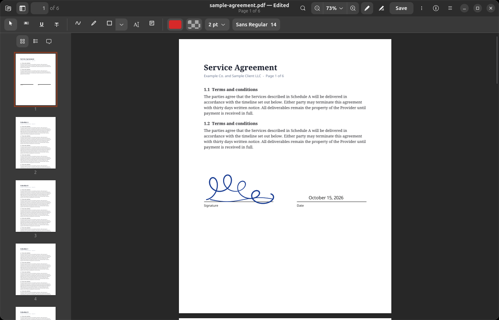
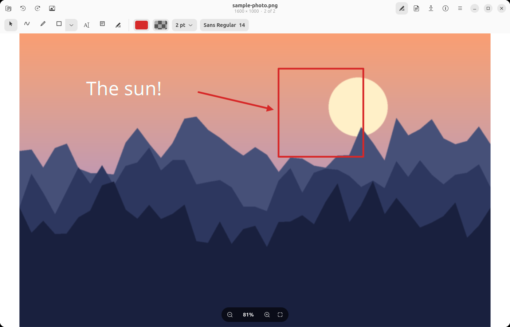
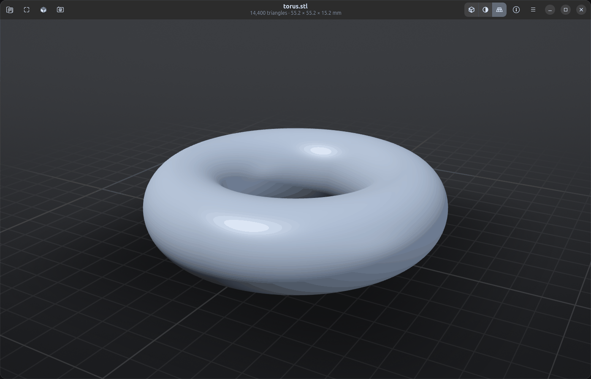
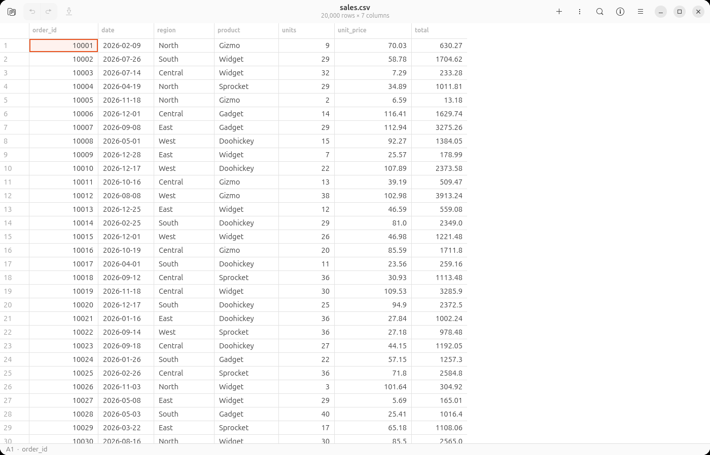

# View

**A macOS-Preview-style viewer for Linux (GNOME) and Windows.** View, annotate and sign PDFs, images, 3D models, tables and video in one fast GTK4 + libadwaita app, including signing with your laptop touchpad.

[](LICENSE)
[](https://github.com/Zdong104/View/releases)
[](https://github.com/Zdong104/View/releases)



<details>
<summary>More screenshots</summary>





</details>

## Features

- **PDF**: fast on huge files (1,000-page and 600 MB scanned PDFs tested), thumbnails, search, text selection, form filling, print, Get Info.
- **Page editing**: select thumbnails and press Delete, reorder, rotate, insert, merge several PDFs, drag pages out. Ctrl+S with pages selected saves just those pages as a new PDF.
- **Export and protect**: export pages to images, password-encrypt, reduce file size.
- **Sign with the touchpad**: your touchpad becomes a 1:1 drawing surface, like macOS Preview. Signatures are stored as vectors. Mouse and pen work too.
- **Markup** on PDFs and images: sketch, shapes, arrows, text boxes, notes, highlight / underline / strikethrough.
- **Images**: zoom, pan, pinch, rotate, flip, crop, adjust colour, instant alpha, resize, EXIF/GPS info. Animated GIF / WebP / APNG keep their animation when edited.
- **Batch tools**: convert selected images, combine images into a PDF.
- **Live Text (OCR)**: select and copy text in images and scanned PDFs, export searchable PDFs (RapidOCR, CPU, English + Chinese).
- **3D models**: STL / OBJ / PLY, orbit with the touchpad, dimensions / volume / area (10M triangles tested).
- **Tables and text**: CSV / TSV viewer and editor (1M rows), text and code viewer with syntax highlighting.
- **Video and audio**, with hardware (VA-API) decoding on Linux.
- **Quick Look for GNOME Files**: press Space to preview a file (replaces Sushi; opt-in).

## Install

### Ubuntu / Debian (.deb)

Download [`view_0.1.4_all.deb`](https://github.com/Zdong104/View/releases/download/v0.1.4/view_0.1.4_all.deb) (or grab it from the [Releases page](https://github.com/Zdong104/View/releases)), then:

```bash
sudo apt install ./view_0.1.4_all.deb
```

Or in one go:

```bash
wget https://github.com/Zdong104/View/releases/download/v0.1.4/view_0.1.4_all.deb && sudo apt install ./view_0.1.4_all.deb
```

`apt` is recommended because it also installs the dependencies. If you prefer `dpkg`:

```bash
sudo dpkg -i view_0.1.4_all.deb && sudo apt -f install
```

### Snap (edge channel)

```bash
sudo snap install view --edge && sudo snap connect view:raw-input
```

The second half lets the sandboxed snap read the touchpad for touchpad signing; without it you can still sign with the mouse, a pen or a finger. If you already installed the snap, just run `sudo snap connect view:raw-input`. Like every install, touchpad signing also needs your user in the `input` group (`sudo usermod -aG input $USER`, then log out and back in).

From a terminal, start it with `snap run view` (plain `view` is usually Vim's read-only mode). The snap is sandboxed, so the GNOME Files integration (Space-bar Quick Look, "Combine Images into PDF") is only available in the .deb / source install.

### Windows (**experimental**)

Download [`View-Setup-0.1.4.exe`](https://github.com/Zdong104/View/releases/download/v0.1.4/View-Setup-0.1.4.exe) (installer) or [`View-0.1.4-windows-portable.zip`](https://github.com/Zdong104/View/releases/download/v0.1.4/View-0.1.4-windows-portable.zip) (no install). It is now tested on a real Windows 11 laptop, but feedback is still very welcome. Touchpad signing works like on Linux: press **Space** (or **Start**) and sign with one finger, no clicking. It needs a Precision Touchpad (most laptops since 2016); otherwise draw with the mouse or a pen.

**New in 0.1.4:**

- **Software updates**: View tells you when a new version is out and installs it for you (see [Updating](#updating)).
- **3D models in virtual machines and over Remote Desktop**: PCs without an OpenGL driver now use built-in software rendering instead of showing "3D Rendering Unavailable".
- **Sharper PDFs**: text no longer looks soft after scrolling, zooming or moving the window to a screen with different scaling.
- **Faster start**: the first window no longer waits for the recent-files list (slow or missing network drives).
- The **first start after installing** can take 20 seconds or more while Windows checks each new file (the build isn't code-signed yet, see below). Later starts take about a second.

**Known problem:** the Windows build isn't code-signed yet, so on PCs with **Smart App Control** turned on (or a work PC with an App Control policy) it stops at startup with *"DLL load failed … An Application Control policy has blocked this file"* ([#3](https://github.com/Zdong104/View/issues/3)). Signed builds fix this; until then it only runs where Smart App Control is off (Windows Security → App & browser control → Smart App Control settings). Without Smart App Control, Windows may show a SmartScreen warning instead: click **More info → Run anyway**.

Text recognition (OCR) is included from 0.1.1 on. It runs in a small helper program, `ocr\view-ocr.exe`, which View starts in the background.

### From source

```bash
git clone https://github.com/Zdong104/View.git
cd View
make run
```

`make install` adds this checkout to your app grid as **View (Dev)**, next to any snap or .deb copy; `make uninstall` removes it again (`make purge` also deletes its Python venv).

### Updating

View checks GitHub for a new release once a day (turn it off in **Preferences → Updates**), and every time you open **About View** or **Check for Updates…** in the main menu. When there is one, it shows what's new and can install it for you:

| Installed with | Update |
| --- | --- |
| Windows installer | **Install and Restart** downloads the new installer, updates View in place and starts it again |
| .deb | **Install…** downloads the new .deb and installs it with `apt` (asks for your password) |
| Snap | The Snap Store updates View automatically; `sudo snap refresh view` updates now |
| Windows portable zip, source | **Download** opens the new download in your browser |

Downloads are checked against the release's `SHA256SUMS` before they are installed. From a terminal, `view-app --check-updates` tells you whether a newer version exists. Every version, including older ones, stays on the [Releases page](https://github.com/Zdong104/View/releases); install an older .deb with `sudo apt install --allow-downgrades ./view_<version>_all.deb`, or run an older Windows installer over the current one.

## Touchpad signing

On Windows it works out of the box with a Precision Touchpad: open **New Signature...** and press **Start**. While you sign, the mouse pointer is paused; press any key to finish. On Linux:

1. Add yourself to the `input` group (needed to read the touchpad directly): `sudo usermod -aG input $USER`, then log out and back in.
2. Open **New Signature...** from the app menu (or run `view-app --new-signature`).
3. Draw with one finger. Where you touch the pad is where the ink goes. Press any key to finish, then place it on a page.

## Compatibility

| System | Status |
| --- | --- |
| Ubuntu 26.04 | ✅ Tested daily |
| Ubuntu 25.10, Debian 13 | Installs and passes the self-test in a container|
| Ubuntu 24.04 | Tested on the snap install |
| Fedora, Arch, other distros | ❓ Untested |
| Windows | ✅ Tested, feedback wanted |
| macOS | Use Mac Preview 🙂 |

## 🙏 Feedback wanted

View is developed and tested **only on Ubuntu 26.04 on a Lenovo ThinkPad P1 Gen 8**. Everything else is a guess, and your report is the most useful thing you can send.

- Tried it on your system? File a [**Platform report**](https://github.com/Zdong104/View/issues/new?template=platform_report.yml), even if everything works.
- Found a problem? Open a [**Bug report**](https://github.com/Zdong104/View/issues/new?template=bug_report.yml).
- Missing something? Open a [**Feature request**](https://github.com/Zdong104/View/issues/new?template=feature_request.yml).
- Questions and ideas: use [Discussions](https://github.com/Zdong104/View/discussions).

## Contributing

Pull requests are welcome, from typo fixes to new viewers. Read [CONTRIBUTING.md](CONTRIBUTING.md) for how to run from source, the project layout and the PR checklist. Everyone taking part is expected to follow the [Code of Conduct](CODE_OF_CONDUCT.md).

## Support the project

View is free. If it saves you time, you can support development:

[](https://buymeacoffee.com/zdong)

GitHub Sponsors is coming soon.

## License

View is licensed under the [PolyForm Noncommercial License 1.0.0](LICENSE): free for personal, educational, research and other noncommercial use. Commercial use or distribution requires permission; open a GitHub issue or contact the maintainer to ask. Note that this makes View *source-available*, not OSI-approved open source.
