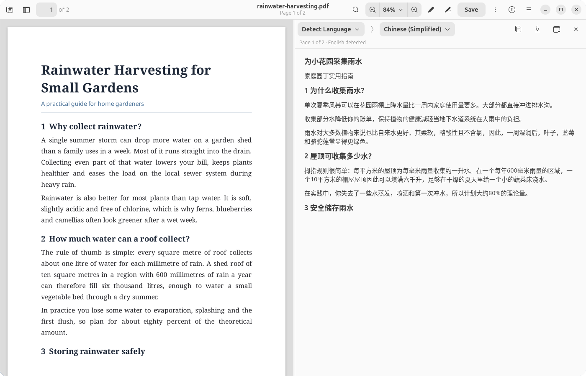
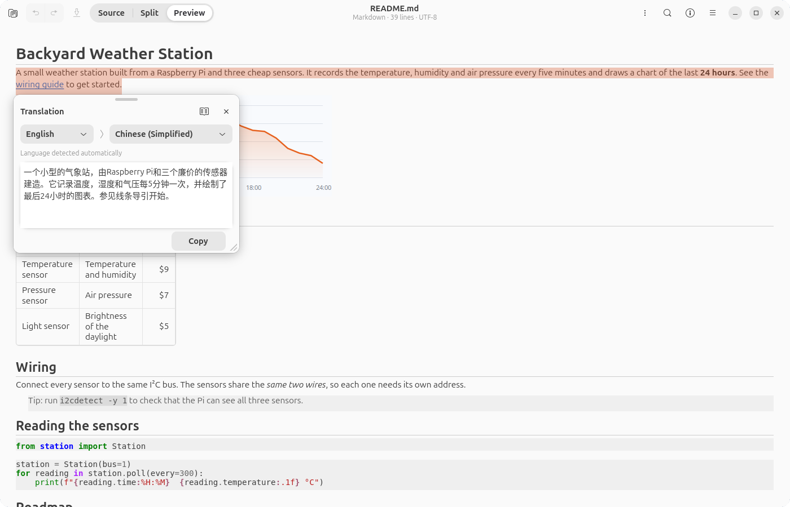
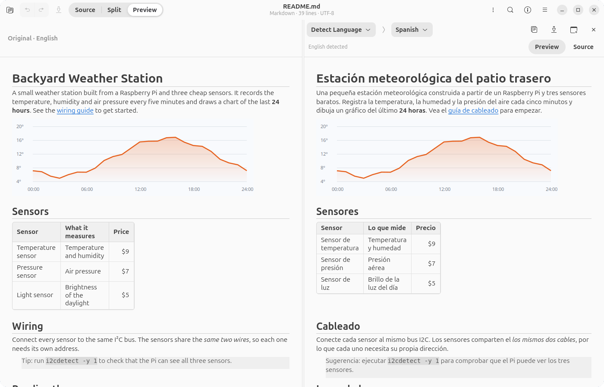
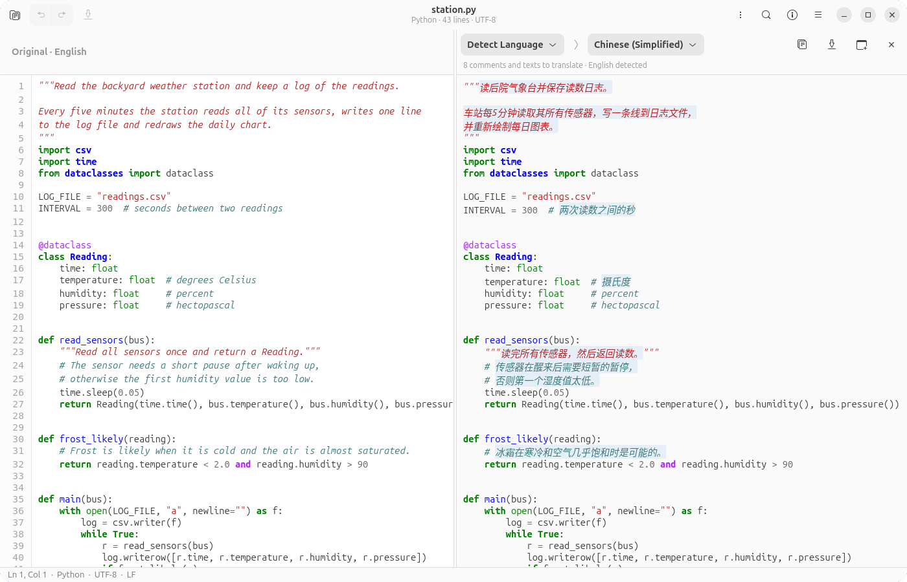
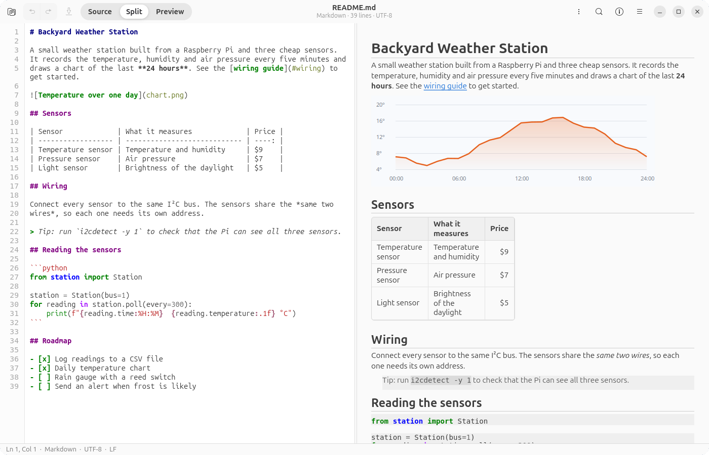
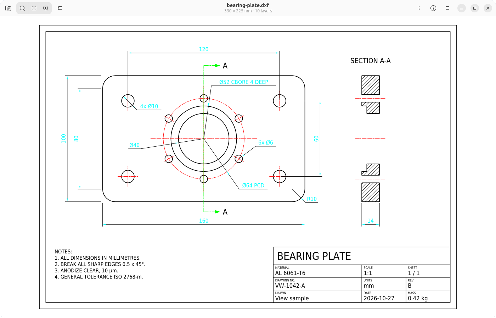
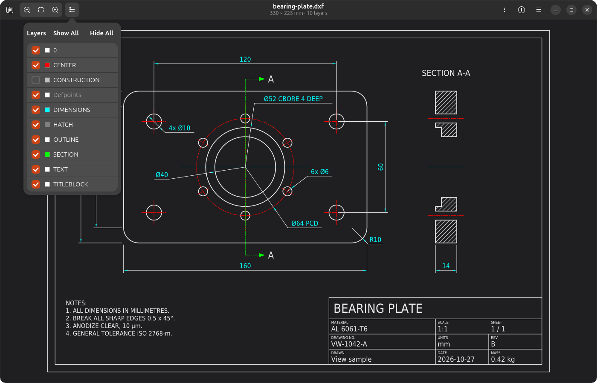

# View

**面向 Linux（GNOME）和 Windows 的 macOS 预览风格查看器，同时提供 Chrome 扩展。** 在一个快速的 GTK4 + libadwaita 应用中查看、批注和签署 PDF、图片、CAD 图纸、3D 模型、Markdown、表格和视频，支持用笔记本触控板签名，还能离线翻译文档。

[](LICENSE)
[](https://github.com/Zdong104/View/releases)
[](https://github.com/Zdong104/View/releases)
[](README.md)



## 0.2.3 新功能

- **大约一秒打开文件。** 关闭最后一个窗口后，View 会留在系统托盘中继续运行，下次打开文件（图片、PDF、视频等）大约一秒就能显示，无需重新启动 View。可从托盘图标或按 Ctrl+Q 退出；如需关闭此功能，请在偏好设置中关闭“关闭所有窗口后让 View 在后台继续运行”。在 GNOME 上，托盘图标需要 AppIndicator 扩展（Ubuntu 默认已开启）；没有托盘时，View 会像以前一样在最后一个窗口关闭时退出。
- **Snap 版启动更快**，首次打开也更快。
- **高质量翻译**：Hy-MT2 1.8B 模型在 GPU 上运行（首次使用时下载），整段翻译成自然的中文，并保留名称、代码和网址不变。

## 0.2.0 新功能

- **离线翻译。** 选中文字即可在浮动卡片中查看译文，也可以把整篇文档左右对照翻译：支持 PDF、Markdown、文本、代码和 CSV 文件。全部在本机运行，不会向外发送任何内容。
- **DXF 图纸（2D CAD）**：带图层面板，支持缩放、平移和深色模式，可导出为 PDF、SVG 或 PNG。
- **Markdown 预览**：可在“源码 / 分栏 / 预览”之间切换，编辑时实时更新。
- **启动更快**：打开图片时不再加载笨重的库，更新检查也会等窗口显示后再进行。
- **Windows：修复了从 0.1.6–0.1.9 升级的问题。** 此前后台截图监视进程会占用 View 的文件，导致安装程序悄无声息地中止；如果升级仍未成功，请参阅 [Windows](#windows实验性) 一节。
- 其他小修复，例如 YAML 文件的语法高亮不再因某些记号类型而失效；在 Windows 上，于偏好设置中关闭“截图”现在会真正停止后台监视进程。

## 截图

<table>
  <tr>
    <td width="50%"><br><sub>在可移动、可调整大小的卡片中翻译选中内容</sub></td>
    <td width="50%"><br><sub>翻译 Markdown，保留文档结构</sub></td>
  </tr>
  <tr>
    <td><br><sub>代码：只翻译注释、文档字符串和字符串</sub></td>
    <td><br><sub>Markdown 分栏视图</sub></td>
  </tr>
  <tr>
    <td><br><sub>DXF 图纸</sub></td>
    <td><br><sub>深色模式与图层面板</sub></td>
  </tr>
  <tr>
    <td><br><sub>签署 PDF</sub></td>
    <td><br><sub>为图片添加标注</sub></td>
  </tr>
  <tr>
    <td><br><sub>3D 模型</sub></td>
    <td><br><sub>CSV / TSV 表格</sub></td>
  </tr>
</table>

## 功能特性

### 文档

- **PDF**：处理超大文件依然流畅（已测试 1,000 页和 600 MB 的扫描版 PDF），支持缩略图、搜索、文本选择、表单填写、打印和获取信息。
- **页面编辑**：选中缩略图后按 Delete 删除，还可以调整顺序、旋转、插入、合并多个 PDF、将页面拖出。选中页面后按 Ctrl+S，可只把这些页面另存为新的 PDF。
- **导出与保护**：将页面导出为图片、设置密码加密、压缩文件大小。
- **触控板签名**：触控板变成 1:1 的绘图板，和 macOS 预览一样。签名以矢量形式保存。鼠标和手写笔同样可用。
- **标注** PDF 和图片：手绘、形状、箭头、文本框、批注，以及高亮 / 下划线 / 删除线。

### 图片

- **图片**：缩放、平移、捏合手势、旋转、翻转、裁剪、调色、一键抠除背景（alpha）、调整尺寸、EXIF/GPS 信息。编辑后的 GIF / WebP / APNG 动图仍会保留动画。
- **截图**：按 Print Screen（Linux）或使用截图工具 / Win+Print Screen（Windows）后，截图会在 View 中打开以便快速标注；点击完成即存回“截图”文件夹并复制到剪贴板。
- **批量工具**：批量转换所选图片，将多张图片合并为 PDF（也可以在 GNOME 文件的右键菜单中直接合并）。

### CAD 与 3D

- **DXF 图纸（2D CAD）**：显示直线、圆弧、样条曲线、文字、尺寸标注、填充图案和图块，并保留图层颜色、线型和线宽。图层面板可以显示或隐藏任意图层（关闭和冻结的图层默认隐藏）；支持触控板平移和捏合缩放，鼠标滚轮以指针为中心缩放；颜色会随深色模式调整。“获取信息”显示单位、尺寸、范围以及图层 / 图块 / 图元数量；“导出为”可输出 PDF、SVG 或 PNG。还能打开写得不够规范的 DXF 文件，例如缺少子类标记或句柄的 CATIA 导出文件或脚本生成文件，这类文件会被严格的解析器拒绝。
- **3D 模型**：支持 STL / OBJ / PLY，可用触控板旋转视角，显示尺寸 / 体积 / 表面积（已测试 1000 万三角面）。

### 文本、代码与表格

- **Markdown**：渲染预览，可在“源码 / 分栏 / 预览”之间切换（默认为预览，会记住你的选择），编辑时实时更新。支持标题、表格、任务列表、引用块、带语法高亮的代码块、本地图片，以及可点击的链接（网页、相对路径文件、`#标题` 锚点）。无需网页引擎，因此在 Windows 上效果完全相同。
- **文本与代码**查看器和编辑器，带语法高亮。
- **表格**：CSV / TSV 查看器和编辑器（支持 100 万行）。

### 翻译与实况文本

- **离线翻译**：选中文字后点击 **翻译**，译文会显示在选区旁的卡片中（可移动、调整大小、复制）；点击 **翻译文档…** 则会左右对照显示整篇文档，原文在左、译文在右，两侧同步滚动。翻译面板也可以拆分到单独的窗口中。
  - **PDF**：跟随当前查看的页面，并提前翻译下一页。公式和图表保持原样。**保存** 会写出整篇文档的译文。
  - **Markdown**：保留文档结构，只翻译正文，代码、链接和标记保持不变，结果可另存为 `.md`。
  - **代码**：只翻译注释、文档字符串和字符串，每一行保持在原来的位置。
  - **CSV / TSV**：行列保持不变，跳过数字、日期、编号和代码。保存时写出翻译后的表格。
  - **图片和扫描页面** 会先经过实况文本识别（需要 OCR 引擎）。
  - 自动检测源语言；文中已经是目标语言的部分会原样保留。
  - 两种模型，可在 **偏好设置 → 翻译 → 模型** 中选择：
    - **高质量**：腾讯的 [Hy-MT2-1.8B](https://huggingface.co/tencent/Hy-MT2-1.8B) 翻译模型，运行在 [llama.cpp](https://github.com/ggml-org/llama.cpp) 上，首次使用时下载约 1.2 GB。它按段落翻译，保留基准名称、代码和缩写原样，覆盖 30 种语言中的 23 种。通过 Vulkan 在 GPU 上运行（每页几秒），没有可用的 GPU 时改用处理器，速度慢得多（每篇文档需要几分钟）。
    - **快速**：CTranslate2 上运行的 Argos Translate 语言包（每个语言对 70–300 MB，首次使用时下载），支持全部 30 种语言，质量较低。瑞典语、希腊语、罗马尼亚语、匈牙利语、芬兰语、丹麦语和挪威语始终使用它。
    - **自动**（默认）：有独立显卡时用高质量，否则用快速。同一页面还会显示模型运行在哪块 GPU 上，可选择默认目标语言，以及删除已下载的模型和语言包。
  - 所有内容都不会离开你的电脑。snap 和 Windows 版本已内置翻译引擎；使用 .deb 或源码安装时，首次翻译时 View 会提示下载引擎（约 45 MB）。
- **实况文本（OCR）**：选择并复制图片和扫描版 PDF 中的文字，导出可搜索的 PDF（RapidOCR，纯 CPU 运行，支持英文和中文）。

### 媒体

- **视频和音频**，在 Linux 上支持硬件（VA-API）解码。

### 系统集成

- **GNOME 文件的快速预览（Quick Look）**：按空格键即可预览文件（取代 Sushi，需手动开启）。
- **界面语言**：English 和简体中文（偏好设置 → 语言，或跟随系统）。欢迎贡献翻译，详见 [CONTRIBUTING.md](CONTRIBUTING.md#translations)。
- **更新**：View 会提示新版本，并可以为你自动安装（见[更新](#更新)）。

## 安装

### Ubuntu / Debian（.deb）

下载 [`view_0.2.3_all.deb`](https://github.com/Zdong104/View/releases/download/v0.2.3/view_0.2.3_all.deb)（也可以从 [Releases 页面](https://github.com/Zdong104/View/releases)获取），然后执行：

```bash
sudo apt install ./view_0.2.3_all.deb
```

或者一条命令完成：

```bash
wget https://github.com/Zdong104/View/releases/download/v0.2.3/view_0.2.3_all.deb && sudo apt install ./view_0.2.3_all.deb
```

推荐使用 `apt`，因为它会一并安装依赖。如果你更习惯用 `dpkg`：

```bash
sudo dpkg -i view_0.2.3_all.deb && sudo apt -f install
```

### Snap（edge 通道）

```bash
sudo snap install view --edge && sudo snap connect view:raw-input
```

后半条命令用于让沙箱中的 snap 读取触控板数据以支持触控板签名；不执行的话，仍然可以用鼠标、手写笔或手指签名。如果已经安装了 snap，只需运行 `sudo snap connect view:raw-input`。和其他安装方式一样，触控板签名还需要把你的用户加入 `input` 组（`sudo usermod -aG input $USER`，然后注销并重新登录）。

在终端中请使用 `snap run view` 启动（直接输入 `view` 通常会进入 Vim 的只读模式）。由于 snap 运行在沙箱中，GNOME 文件的空格键快速预览仅在 .deb / 源码安装中可用。右键菜单中的“合并图片为 PDF”只需一次性设置即可使用（需要 `python3-nautilus`，最后一步会重启文件管理器）：

```bash
sudo apt install python3-nautilus && mkdir -p ~/.local/share/nautilus-python/extensions && snap run view --print-files-extension > ~/.local/share/nautilus-python/extensions/view-app.py && nautilus -q
```

.deb 会在已安装 `python3-nautilus` 时自动提供这个菜单项（`apt` 会推荐安装它）。

### Windows（**实验性**）

下载 [`View-Setup-0.2.3.exe`](https://github.com/Zdong104/View/releases/download/v0.2.3/View-Setup-0.2.3.exe)（安装程序）或 [`View-0.2.3-windows-portable.zip`](https://github.com/Zdong104/View/releases/download/v0.2.3/View-0.2.3-windows-portable.zip)（免安装）。目前已在真实的 Windows 11 笔记本上测试过，但仍非常欢迎你的反馈。触控板签名的用法和 Linux 上一样：按 **Space**（或 **Start**），然后用一根手指签名，无需点击。它需要精确式触控板（Precision Touchpad，2016 年以来的大多数笔记本都有）；否则请用鼠标或手写笔书写。

**从 0.1.6–0.1.9 升级：** 这些版本的后台截图监视进程会占用 View 的文件，导致安装程序可能在没有任何提示的情况下中止。0.2.0 的安装程序会自行结束该进程，即使升级是由旧版 View 发起的也同样有效。如果升级仍未成功，请在任务管理器中结束后台的 **View** 进程（或运行 `taskkill /F /IM View.exe`），然后重新运行 `View-Setup-0.2.3.exe`。

**安装后的首次启动**可能需要 20 秒甚至更久，因为 Windows 会逐个检查新文件（该版本尚未进行代码签名，见下文）。之后的启动大约只需一秒。

**已知问题：** Windows 版本尚未进行代码签名，因此在开启了**智能应用控制（Smart App Control）**的电脑上（或带有应用控制策略的工作电脑上），启动时会中断并提示 *"DLL load failed … An Application Control policy has blocked this file"*（[#3](https://github.com/Zdong104/View/issues/3)）。签名版本可以解决这个问题；在此之前，它只能在关闭智能应用控制的电脑上运行（Windows 安全中心 → 应用和浏览器控制 → 智能应用控制设置）。如果没有开启智能应用控制，Windows 可能会改为弹出 SmartScreen 警告：点击 **更多信息 → 仍要运行** 即可。

文本识别（OCR）和翻译分别运行在小型辅助程序 `ocr\view-ocr.exe` 和 `translate\view-translate.exe` 中，由 View 在后台启动。翻译语言包会在首次使用某个语言对时下载；高质量模型会在旁边下载 llama.cpp 的官方 Windows 版本（Vulkan，带 CPU 后备）并以同样方式运行。

### Chrome 扩展

View 也以扩展的形式支持 Chrome。

1. 下载 [`view-chrome-0.2.3.zip`](https://github.com/Zdong104/View/releases/download/v0.2.3/view-chrome-0.2.3.zip) 并解压。
2. 打开 `chrome://extensions`，开启 **开发者模式**，点击 **加载已解压的扩展程序**，然后选择解压出的文件夹。
3. 如需打开本地文件，请点击 View 的 **详细信息**，并开启 **允许访问文件网址**。

### 从源码安装

```bash
git clone https://github.com/Zdong104/View.git
cd View
make run
```

`make install` 会把当前检出的目录添加到应用网格中，名称为 **View (Dev)**，与 snap 或 .deb 版本并存；`make uninstall` 可将其移除（`make purge` 还会删除它的 Python 虚拟环境）。`make ocr` 和 `make translate` 可分别把可选的 OCR 引擎和翻译引擎安装到该虚拟环境中。

### 更新

View 每天会向 GitHub 检查一次新版本（可在 **偏好设置 → 更新** 中关闭），每次打开 **关于 View** 或主菜单中的 **检查更新…** 时也会检查。发现新版本时，它会显示更新内容，并可以为你自动安装：

| 安装方式 | 更新方式 |
| --- | --- |
| Windows 安装程序 | **安装并重启** 会下载新的安装程序，原地更新 View 并重新启动 |
| .deb | **安装…** 会下载新的 .deb 并通过 `apt` 安装（会要求输入密码） |
| Snap | Snap Store 会自动更新 View；也可以运行 `sudo snap refresh view` 立即更新 |
| Windows 便携版 zip、源码 | **下载** 会在浏览器中打开新版本的下载页面 |

下载的文件在安装前会与该版本发布的 `SHA256SUMS` 进行校验。在终端中运行 `view-app --check-updates` 可以查看是否有新版本。所有版本（包括旧版本）都保留在 [Releases 页面](https://github.com/Zdong104/View/releases)；安装旧版 .deb 可使用 `sudo apt install --allow-downgrades ./view_<version>_all.deb`，旧版 Windows 安装程序则可直接覆盖运行在当前版本之上。

## 触控板签名

在 Windows 上，配备精确式触控板即可开箱即用：打开 **新建签名...** 并按 **Start**。签名时鼠标指针会暂停移动；按任意键结束。在 Linux 上：

1. 将自己加入 `input` 组（直接读取触控板需要此权限）：`sudo usermod -aG input $USER`，然后注销并重新登录。
2. 从应用菜单中打开 **新建签名...**（或运行 `view-app --new-signature`）。
3. 用一根手指书写。你触摸触控板的位置，就是墨迹出现的位置。按任意键结束，然后把签名放到页面上。

## 兼容性

| 系统 | 状态 |
| --- | --- |
| Ubuntu 26.04 | ✅ 每日测试 |
| Ubuntu 25.10、Debian 13 | 在容器中可安装并通过自检 |
| Ubuntu 24.04 | 已在 snap 安装方式下测试 |
| Fedora、Arch 等其他发行版 | ❓ 未测试 |
| Windows | ✅ 已测试，欢迎反馈 |
| Chrome 扩展 | ✅ 已测试 |
| macOS | 用 Mac 自带的预览吧 🙂 |

## 🙏 期待你的反馈

View 仅在 **联想 ThinkPad P1 Gen 8 上的 Ubuntu 26.04** 中开发和测试。其他环境都只是推测，你的反馈是最有价值的帮助。

- 在你的系统上试过了？请提交一份[**平台报告**](https://github.com/Zdong104/View/issues/new?template=platform_report.yml)，即使一切正常也请告诉我们。
- 发现问题？请提交[**Bug 报告**](https://github.com/Zdong104/View/issues/new?template=bug_report.yml)。
- 缺少某个功能？请提交[**功能建议**](https://github.com/Zdong104/View/issues/new?template=feature_request.yml)。
- 提问和想法：请使用 [Discussions](https://github.com/Zdong104/View/discussions)。

## 参与贡献

欢迎提交 Pull Request，无论是修正错别字还是新增查看器都可以。请阅读 [CONTRIBUTING.md](CONTRIBUTING.md)，了解如何从源码运行、项目结构以及 PR 检查清单。所有参与者都应遵守[行为准则](CODE_OF_CONDUCT.md)。

## 贡献者

- [@azkuang](https://github.com/azkuang)：界面翻译框架与简体中文本地化。

## 支持本项目

View 是免费的。如果它帮你节省了时间，欢迎支持项目的开发：

[](https://buymeacoffee.com/zdong)

GitHub Sponsors 即将上线。

## 许可证

View 采用 [PolyForm Noncommercial License 1.0.0](LICENSE) 授权：个人、教育、研究及其他非商业用途免费。商业使用或分发需获得许可；请提交 GitHub issue 或联系维护者咨询。请注意，这意味着 View 是*源码可见（source-available）*项目，而非经 OSI 认证的开源软件。
